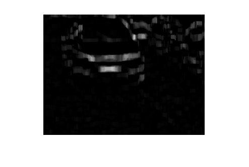
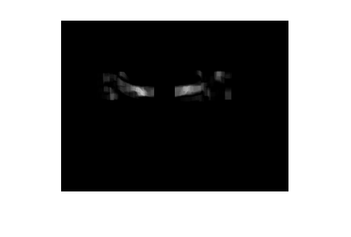
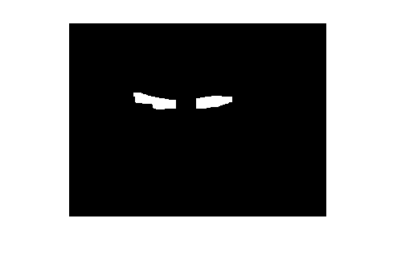
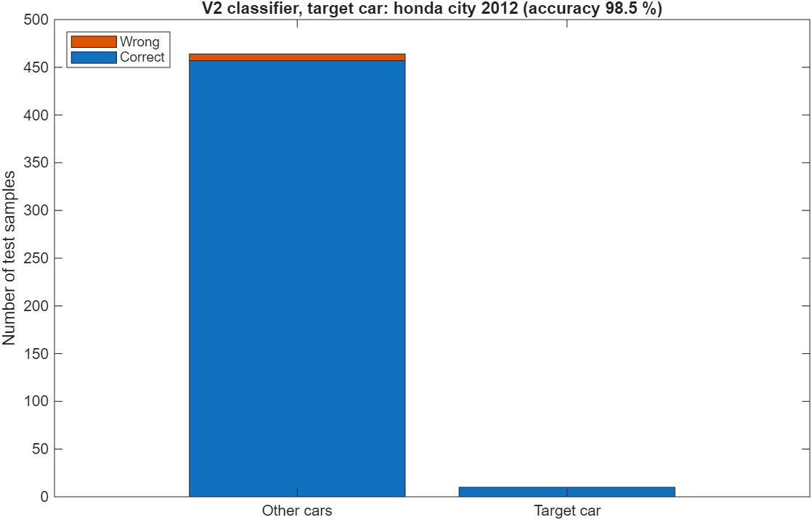

# Car Model Detection

A classical computer-vision project in MATLAB that recognises a specific car model and year from a front-view photo, without deep learning. It locates the number plate and headlights, measures their geometry and appearance, and passes the features to a vote of three classifiers.

The cars covered are common Malaysian models: Honda City, Axia, Myvi, Persona, Saga and Waja, in several model years.

## How it works

1. **Number-plate detection** (`lp_detection.m`): finds the plate using edge and morphological filtering.
2. **Headlight detection** (`hl_detection.m`): looks for the headlights, using the plate position as a guide.
3. **Feature extraction** (`feature_select.m`): builds a 140-value feature vector per image from the detected regions.
4. **Classification**: a target car is compared against all the others. k-NN (k = 3, 5, 7), an RBF-kernel SVM and a decision tree each vote, and the majority decides.

Some intermediate images from the detection stages:

| | | |
|---|---|---|
|  |  |  |

## Quick start

```matlab
run_example     % V2 classifier on the saved features; no images needed
```

Needs Image Processing Toolbox (for the detection steps) and Statistics and Machine Learning Toolbox. The file paths use Windows separators. Only run on R2025b so far.

## Versions

| Folder | Purpose | Main script |
|---|---|---|
| `V1` | Separate training and test folders; reports accuracy for a target car | `Classification.m` |
| `V2` | One folder, split automatically (70 % training by default); reports accuracy for a target car | `Classification_Auto.m` |
| `V3` | You pick an image and it says whether it shows the target car | `Classification_single.m` |

To choose the target car, put its feature file in `Features/Target` (and `Test/Target` in V1).

To extract features for your own photos, put them in `Data_Train` (and `Data_Test` in V1), one folder per car, and run `FS_train.m` (and `FS_test.m` in V1).

## Results

From the saved features, with a fixed random seed:

| Version | Target car | Samples tested | Accuracy | False positives | False negatives |
|---|---|---:|---:|---:|---:|
| V1 | Persona 2008 | 141 | 79.4 % | 16 | 13 |
| V2 | Honda City 2012 | 474 | 98.5 % | 7 | 0 |



**Read these numbers with care.** V1 tests on a separate folder, so it is the fairer figure. In V2 the test samples overlap with the training samples, and most samples are not the target car, so its 98.5 % is optimistic.

## What's included

- The extracted features (`.mat` files) in `V1/Features`, `V1/Test` and `V2/Features`.
- **The photos are not included**, so the feature-extraction scripts and V3 need your own images. They have not been re-run since the photos were removed. V3 also has no saved features, so run its `FS_train.m` first.
