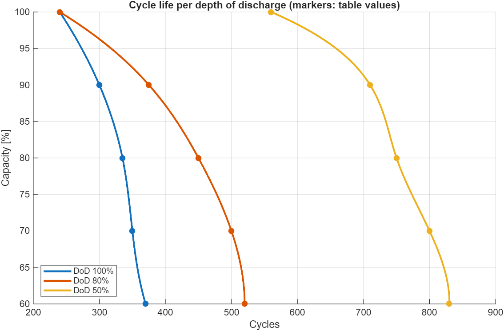
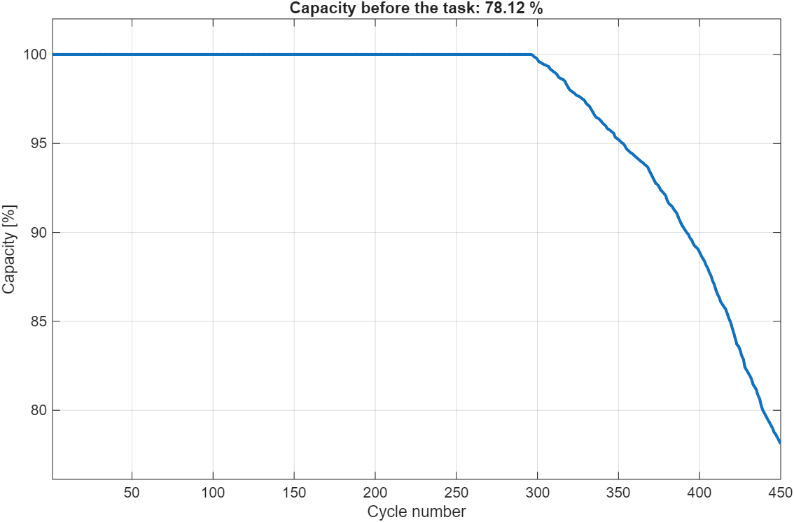
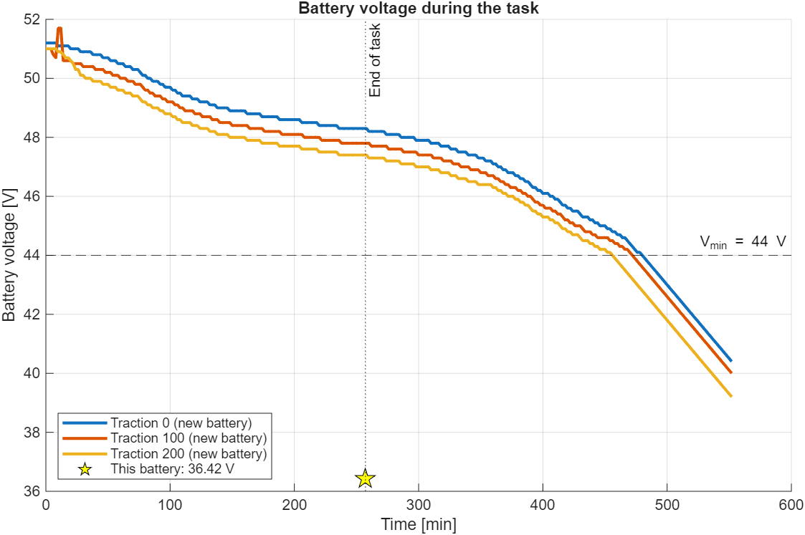

# Battery Task Simulation

A MATLAB model that estimates what state a 52 V battery is in before and after a driving task. It takes into account how hard the battery has been used before, measured as cycles at different depths of discharge (DoD).

Given the previous cycles and a task (distance, standby time and traction setting), it estimates:

- the **capacity left** before the task, after fade from earlier cycles
- the **battery voltage** at the end of the task
- the **average power** drawn during the task
- the **time left** until the voltage reaches the 44 V minimum
- the **remaining cycle life** at 100 %, 80 % and 50 % DoD

## Quick start

```matlab
% from the "Energy Simulation" folder
run examples/example_basic.m     % fixed inputs, prints results, saves figures
run run_interactive.m            % asks for the inputs in the Command Window
```

To use the model from your own code:

```matlab
addpath src
cfg = battery_default_config();
cfg.cycles      = [150 150 150];  % previous cycles at DoD 100 / 80 / 50 %
cfg.distance_m  = 5000;           % task distance [m]
cfg.standby_min = 30;             % standstill time within the task [min]
cfg.traction    = 100;            % 0, 100 or 200
res = battery_task_sim(cfg);
print_battery_report(res);
plot_battery_results(res);
```

Needs MATLAB R2020a or newer and no toolboxes, going by the functions used. It has only been run on R2025b.

## Example results

The example uses 450 previous cycles (150 at each DoD), followed by a 5 km task with 30 min of standby at traction 100:

| Output | Value |
|---|---|
| Capacity before the task | 78.12 % |
| Battery voltage after the task | 36.42 V |
| Average power during the task | 377.39 W |
| Task duration | 257.2 min |
| Cycles left (DoD 100 / 80 / 50 %) | 29 / 57 / 70 |

### Cycle life per depth of discharge
The table values (markers) give the number of cycles at which the battery reaches 100, 90, … 60 % capacity. The model interpolates them with a spline. In this table, the 50 % DoD curve reaches far more cycles than the other two.



### Capacity fade over the previous cycles
The 450 previous cycles are applied in a random order. The first ~300 use up the battery's "new" life with no capacity loss. After that, each cycle moves the battery along its DoD curve, and capacity drops to 78 %.



### Voltage during the task
Voltage logs of about 8 hours for the three traction settings (lines), extended by extrapolation past the end of the logs. The star is this battery at the end of the task, after correcting for its lost capacity.



## How it works

1. **Cycle life.** `data_1` lists the cycles reached at each capacity for each DoD. It is spline-interpolated onto a fine capacity grid.
2. **Usage order.** The previous cycles are shuffled, because in real use the DoD changes from one charge to the next.
3. **Capacity fade.** Each cycle at a given DoD uses up `1/N` of the battery's new life, where `N` is that DoD's cycle count at 100 % capacity. Once the fractions add up to 1, each further cycle moves the battery one cycle along its DoD curve, which lowers the capacity.
4. **The task.**
   - Task time is `distance / (0.36 m/s × 0.9)`.
   - The voltage at that time is read from the log for the chosen traction setting.
   - It is then lowered by `52 V × (1 − capacity)` to account for capacity fade.
   - Average power combines the standby power (243.5 W) with the driving power for that traction setting.
5. **Remaining life.** The cycles left until the end of each DoD curve (60 % capacity).

## Project layout

```
Energy Simulation/
├── README.md
├── run_interactive.m          prompts for inputs and runs the model
├── examples/
│   └── example_basic.m        fixed inputs; regenerates the figures below
├── src/
│   ├── battery_default_config.m   all inputs and constants in one place
│   ├── battery_task_sim.m         the model
│   ├── extract_data.m             splits a drive log into columns
│   ├── plot_battery_results.m     the three figures
│   └── print_battery_report.m     Command Window summary
├── data/
│   └── data.mat               cycle-life table + three drive logs
└── figures/                   generated by examples/example_basic.m
```

### Data (`data/data.mat`)

| Variable | Size | Contents |
|---|---|---|
| `data_1` | 5 × 6 | `[capacity %, cycles @ DoD 100, capacity %, cycles @ DoD 80, capacity %, cycles @ DoD 50]` |
| `sc_1`, `sc_2`, `sc_3` | ~230 × 6 | Drive logs for traction 0 / 100 / 200: `[time min, power W, temperature °C, distance m, speed m/s, voltage V]` |

## Limitations

- **Time left ignores capacity fade.** The end-of-task voltage is corrected for capacity fade, but the time left until 44 V is read from the uncorrected (new-battery) curve. That is why the example shows 36.4 V at the end of the task *and* 215 min left.
- **Simple voltage correction.** The fade correction scales the full 52 V by the lost capacity. This is a rough approximation, not an electrochemical model.
- **Extrapolation.** The drive logs cover about 8 hours. Beyond that, voltage is extrapolated linearly.
- **Randomness.** Results depend on the random order of previous cycles. Call `rng(seed)` first if you need them to repeat.
- **Fixed constants.** The 0.9 speed factor and the "−2 cycles" offset in the remaining-life estimate are carried over from the original model.
