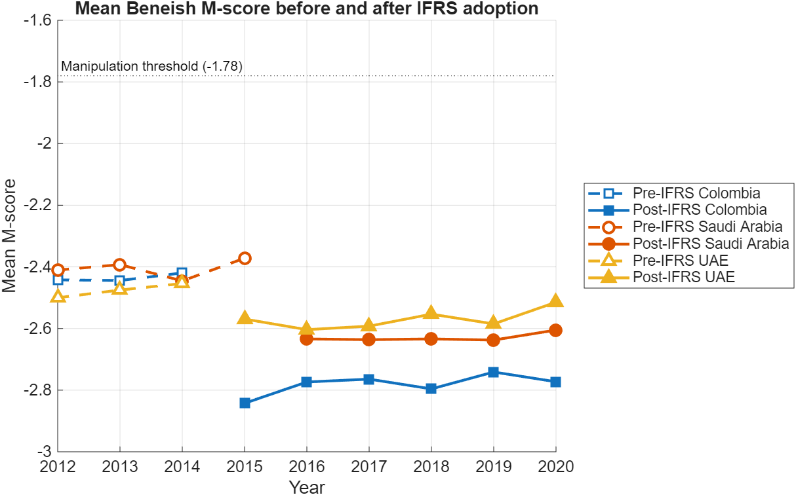
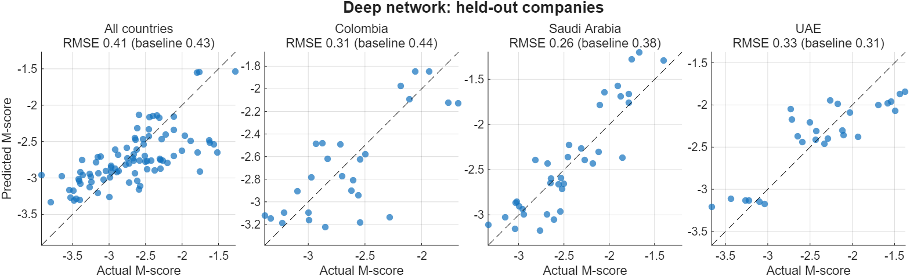
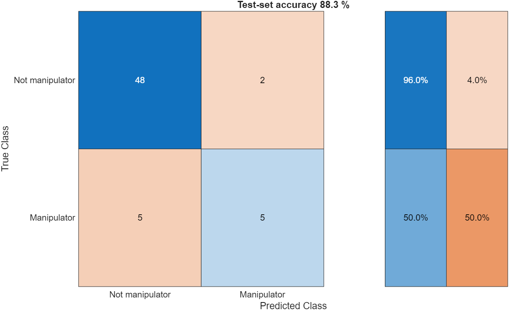

# Earnings Manipulation and IFRS Adoption

MATLAB code from a study of **white-collar crime in financial reporting**. It compares earnings-manipulation scores of companies before and after the adoption of International Financial Reporting Standards (IFRS) in **Colombia, Saudi Arabia and the United Arab Emirates** (2012–2020).

Manipulation is measured with the **Beneish M-score**. It combines eight financial-statement ratios, and values above **−1.78** flag a likely manipulator.

The code covers four analyses:

| # | Question | Method |
|---|---|---|
| 1 | Did the average M-score fall after IFRS adoption? | Mean M-score per year, before and after adoption, per country |
| 2 | Can a company's post-IFRS M-scores be predicted from its pre-IFRS M-scores? | Shallow feed-forward network (`fitnet`) |
| 3 | Same question, per country | Deep network (fully connected + LSTM) |
| 4 | Can manipulators be told apart from a set of input features? | Linear classifier (`patternnet` with no hidden layer), also written out as an explicit formula |

> **About the data.** The study data is not included. The repository has a generator for **synthetic data** (`data/make_synthetic_data.m`), so all the code runs as-is.
>
> **Every number and figure below comes from that random data and says nothing about real companies or about IFRS.** The generator builds in the post-IFRS drop, and it labels the classifier data with the Beneish formula, so these results only show that the code works. For analysis 4, the eight Beneish ratios are an illustrative choice of features.

## Quick start

```matlab
% from the "White Collar Crimes" folder
run examples/example_synthetic.m
```

This creates the synthetic workbooks if they are missing, runs all four analyses, prints the results and saves the figures to `figures/`. It takes about 1–2 minutes on a laptop CPU.

To run it on your own data in the same layout (see [Data format](#data-format)):

```matlab
addpath src
out = run_analysis('my_mscores.xlsx', 'my_ratios.xlsx', 'figures');
```

**Requirements:** MATLAB R2024a or newer and Deep Learning Toolbox. It has only been run on R2025b.

## Results (synthetic data)

### 1. M-score before and after IFRS
The generator puts a drop in M-score after adoption (2015, or 2016 for Saudi Arabia), and the trend plot shows it.



| Group | Companies | Mean M-score pre-IFRS | Mean M-score post-IFRS |
|---|---:|---:|---:|
| All countries | 200 | −2.44 | −2.64 |
| Colombia | 60 | −2.44 | −2.78 |
| Saudi Arabia | 80 | −2.41 | −2.63 |
| UAE | 60 | −2.48 | −2.57 |

### 2–3. Predicting post-IFRS M-scores
Both networks are scored on **held-out companies they never saw during training**. They are compared with a simple baseline that predicts each post-IFRS year as the company's own pre-IFRS average.

Test sets are small (9–30 companies), so the table shows averages over 10 random train/test splits (`examples/repeat_splits.m`):

| Model | Group | Mean test RMSE | Mean baseline RMSE | Splits where it beat the baseline |
|---|---|---:|---:|---:|
| Shallow network | All countries | 0.365 | 0.413 | 10 of 10 |
| Deep network | All countries | 0.383 | 0.426 | 9 of 10 |
| Deep network | Colombia | 0.330 | 0.467 | 10 of 10 |
| Deep network | Saudi Arabia | 0.317 | 0.361 | 8 of 10 |
| Deep network | UAE | 0.375 | 0.370 | 5 of 10 |

The figure shows a single split, from `examples/example_synthetic.m` (seed 7), so its RMSE values differ from the table:



The networks usually beat the baseline on this data, except the deep network for the UAE, which is level with it. The shallow and deep networks were not run on the same splits, so their RMSEs are not a like-for-like comparison.

### 4. Manipulator classifier
Each test set has 60 held-out companies. Over the 10 splits:
- **Accuracy:** mean 84.3 % (range 73.3–91.7 %).
- **Manipulators caught:** mean 50.1 % (range 33.3–76.9 %). Manipulators are the minority class, so overall accuracy looks better than the classifier's ability to find them.

The chart shows one split (seed 7), with 88.3 % accuracy:



The classifier has no hidden layer, so its decision is a single linear rule. For that split, with each ratio first scaled to [−1, 1]:

```
manipulator  if  3.50·DSRI + 1.34·GMI + 0.89·AQI + 2.64·SGI − 0.30·DEPI
                 − 0.11·SGAI − 0.26·LVGI + 4.09·TATA − 1.64  >  0
```

`classify_manipulators` rebuilds this rule from the trained weights and checks that it gives the same class as the network (100 % agreement in this run). The weights apply to scaled inputs, so they can't be compared directly with Beneish's published coefficients, and because the labels were generated from his formula they don't validate it.

## Project layout

```
White Collar Crimes/
├── README.md
├── examples/
│   ├── example_synthetic.m      runs everything on synthetic data
│   └── repeat_splits.m          repeats the comparison over 10 random splits
├── src/
│   ├── run_analysis.m           the whole study: loads data, runs 1-4, saves figures
│   ├── load_mscores.m           reads one sheet of yearly M-scores
│   ├── plot_ifrs_trend.m        analysis 1
│   ├── fit_mscore_shallow.m     analysis 2
│   ├── fit_mscore_deep.m        analysis 3
│   ├── classify_manipulators.m  analysis 4 (+ the hand-written rule)
│   ├── plot_predictions.m       predicted-vs-actual panels
│   ├── split_companies.m        random train/test split
│   └── apply_light_theme.m      white figure background
├── data/
│   ├── make_synthetic_data.m    writes the two synthetic workbooks
│   ├── synthetic_mscores.xlsx
│   └── synthetic_ratios.xlsx
└── figures/
```

## Data format

**M-score workbook.** One sheet per group: `Sh1` (all countries), `Sh_c` (Colombia), `Sh_s` (Saudi Arabia), `Sh_u` (UAE). Each sheet has one header row, then one row per company:

| Company | Country | M2012 | … | M2020 | Manipulator |
|---|---|---|---|---|---|

Any number of identifier columns may come first. The code reads the **nine columns before the last one** as the yearly M-scores. Rows with missing values are dropped.

**Ratio workbook.** Sheet `Model1`: one column per feature (e.g. `DSRI GMI AQI SGI DEPI SGAI LVGI TATA`), then a final 0/1 label column.

## Notes on the method

- **Train/test split.** Every model is scored on companies held out from training. All three models also hold back part of their training set for early stopping.
- **Early stopping was added after seeing test results.** Without it, the deep network did worse than the baseline on the seed-7 split. The 10-split table was run afterwards, but the synthetic data is the same, so treat it as a code check rather than an unbiased benchmark.
- **Fixed seeds.** `rng(7)` in the example and seeds 1–10 in `repeat_splits.m` make the runs repeatable on the same MATLAB version.
- **Adoption year.** The pre/post split is 2012–2014 / 2015–2020, and 2012–2015 / 2016–2020 for Saudi Arabia.
- **Prediction target.** The networks predict the last three years of the period.

## Changes from the original scripts

- The eight scripts were merged into functions. The per-country copies became a parameter.
- **Fixed:** the UAE script read the Saudi sheet (`Sh_s`). It now reads `Sh_u`.
- **Evaluation:** the originals evaluated on data used for training, or validated on the training set. All models now use held-out companies.
- **Shallow network:** 10 hidden neurons instead of the original 500.
- **Saudi Arabia, deep network:** predicts the last three years, like the other groups, instead of only the last year.
- **Deep network:** trained with `trainnet` instead of `trainNetwork`. The architecture is unchanged.
- **Hand-written classifier rule:** the original used only the second output row with `tansig`. The rule now uses the difference between the two rows, which is what the softmax output actually decides on.
- **Trend plot:** shows the three countries. The "all countries" line and the Saudi-only plot were dropped.
